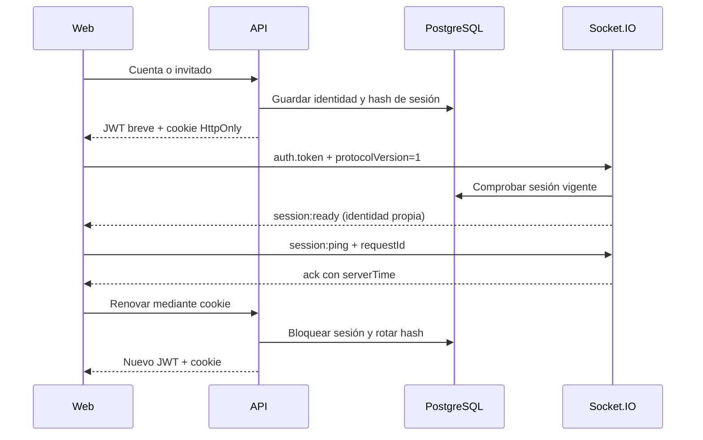

# Fase 1: base funcional

La implementación parte del plan `../entregables/plan_desarrollo/Apuntado_Plan_de_Desarrollo.docx` en la carpeta de la materia y del esquema del Entregable 2. El producto se desarrolla en `apuntado`; los materiales entregados se mantienen como evidencia independiente.

## Decisiones implementadas

| Área              | Decisión                                                                                               |
| ----------------- | ------------------------------------------------------------------------------------------------------ |
| Runtime           | Node 24 LTS; TypeScript estricto; npm workspaces y lockfile                                            |
| Servidor          | Express 5, una instancia; rutas de identidad separadas del adaptador de tiempo real                    |
| Web               | React 19, Vite 8, Redux Toolkit, React Hook Form; UI en español                                        |
| Persistencia      | PostgreSQL 18, `pg`, migraciones con `node-pg-migrate`                                                 |
| Validación        | Zod en servidor y cliente; los tipos compartidos no reemplazan la validación del servidor              |
| Acceso            | Cuenta con correo/contraseña o identidad de invitado                                                   |
| Credenciales      | Argon2id, JWT firmado HS256 de 10 minutos y renovación opaca de 14 días                                |
| Tiempo real       | Socket.IO 4, exclusivamente `websocket`, protocolo de aplicación versión 1                             |
| Origen            | Mismo origen para web, API y WebSocket: proxy de Vite local y archivos compilados servidos por Express |
| Reglas preparadas | Clásica y Apuntado versión 2; duración de turno de 30 segundos                                         |

La separación C1–C7 del Entregable 2 continúa vigente como diseño de responsabilidades. Esta fase implementa identidad, configuración, la base de persistencia y el adaptador inicial de C7. No da por implementados C1–C5: todavía faltan sala, coordinación de partida, evaluadores, liquidación y vistas de juego. Las tablas de partida se preparan ahora para que los siguientes casos de uso se integren mediante migraciones y transacciones explícitas.

## Base de datos

Hay **16 tablas de aplicación**, una vista de puntajes y la tabla técnica de control de migraciones. Los nombres y relaciones de las 11 tablas académicas se preservan en la primera migración. La segunda amplía el modelo.

| Tablas                                                  | Propósito                                                                    |
| ------------------------------------------------------- | ---------------------------------------------------------------------------- |
| `player`, `account`, `auth_session`                     | Identidad, credenciales opcionales y sesiones revocables                     |
| `rule_profile`                                          | Perfiles versionados e inmutables, incluidos los parámetros del turno        |
| `game`, `participation`, `round`, `round_participation` | Sala/partida, pertenencia, asiento y conjunto de participantes de cada ronda |
| `card_copy`, `card_position`                            | Copias físicas y ubicación de cartas por ronda                               |
| `round_result`, `score_movement`                        | Acta y movimientos acumulables; `current_score` calcula el total             |
| `hand_evaluation`, `evaluation_card`                    | Explicación de evaluación y agrupación de cartas para el acta futura         |
| `processed_operation`, `outbox`                         | Base para idempotencia y publicación después del commit                      |

`account.player_id` es único: un jugador puede tener una cuenta o ninguna. Una invitación no crea una cuenta ficticia. `auth_session` conserva hashes SHA-256 de credenciales aleatorias de 256 bits, expiración y revocación. El hash de contraseña incluye sal y parámetros Argon2id (19 MiB, dos iteraciones, paralelismo 1).

Los perfiles originales `classic-v1` y `apuntado-v1` permanecen intactos. `classic-v2` define 30 segundos y no puntúa; `apuntado-v2` define 30 segundos, premios +10/+25, toque máximo 5, eliminación en −101 y victoria en +51. La inmutabilidad de perfiles impide cambiar reglas a una partida existente. Los temporizadores y las acciones automáticas todavía no se ejecutan: solo se prepararon sus datos.

Se añadieron pertenencia por ronda, asiento único entre participantes que no han salido, reloj persistente, evaluación de mano y actor de sistema para futuros vencimientos. `outbox.published_at` significa publicación por el servidor, no confirmación de recepción por todos los clientes.

Los mínimos del juego (104 cartas exactas, 2–6 jugadores al iniciar, 10/11 cartas según fase, actor activo, conservación de cartas, reglas de cierre y plazo) necesitan validación de casos de uso en la fase siguiente. Las restricciones SQL no implementan por sí mismas el motor del juego.

Las migraciones fundacionales no ofrecen un `down` que borre datos. Para corregir una base con información se crea otra migración o se restaura un respaldo. No se deben editar migraciones ya aplicadas. Los SQL leídos por esas migraciones forman parte de su contenido versionado.

## Contrato HTTP

Todas las respuestas de `/api` incluyen `Cache-Control: no-store`. Los POST requieren `Origin` permitido, `Content-Type: application/json` y `X-Apuntado-Client: 1`. El origen y CORS no sustituyen la credencial.

| Método y ruta             | Entrada / resultado                                                    |
| ------------------------- | ---------------------------------------------------------------------- |
| `POST /api/auth/register` | `{displayName,email,password}` → 201, identidad, JWT y cookie          |
| `POST /api/auth/login`    | `{email,password}` → 200, misma identidad de cuenta, nueva sesión      |
| `POST /api/auth/guest`    | `{displayName}` → 201, nueva identidad de invitado y sesión            |
| `POST /api/auth/refresh`  | `{}` + cookie → 200, JWT y cookie rotada                               |
| `POST /api/auth/logout`   | `{}` + cookie → 204; revoca sesión y desconecta sus sockets            |
| `GET /api/auth/me`        | `Authorization: Bearer <JWT>` → identidad propia                       |
| `GET /api/health`         | Estado del proceso                                                     |
| `GET /api/ready`          | Disponibilidad de PostgreSQL y tabla de sesiones; 503 si no está lista |

La identidad pública contiene únicamente `id`, `displayName` y `kind`. Los errores usan `{error:{code,message,fields?}}` con estados 400, 401, 403, 409, 413, 415, 429 o 500 según el caso. No se exponen hashes, consultas SQL, trazas ni tokens en registros.

El correo se normaliza con trim/minúsculas y se protege con unicidad SQL; una colisión revierte la creación del jugador. Los nombres no constituyen credenciales. Los intentos de acceso se limitan a 40 por IP cada 15 minutos en el proceso; este límite es una primera defensa local y se debe revisar en el alojamiento real y con redes compartidas.

## Sesión y conexiones

La cookie se limita a `/api/auth`, es `HttpOnly` y `SameSite=Lax`. En producción usa el nombre `__Secure-apuntado_refresh` y el atributo `Secure`. El token de acceso permanece en memoria de Redux. Las pestañas coordinan renovaciones con Web Locks y comunican salida/cambio de sesión mediante BroadcastChannel, sin intercambiar tokens.

La renovación bloquea la fila con `FOR UPDATE`. Si dos solicitudes usan la misma credencial, una gana y la otra recibe `409 REFRESH_CONFLICT` durante una tolerancia de diez segundos; no invalida una sesión por esa carrera. Después de la tolerancia, reutilizar la credencial inmediatamente anterior revoca la sesión. Una credencial desconocida o más antigua se rechaza. No se mantiene un historial completo de todos los hashes utilizados.

Una pérdida de respuesta después de rotar la cookie puede requerir iniciar sesión de nuevo: no se conserva un token de renovación en texto claro para reproducir la respuesta. Esta limitación es especialmente relevante para invitados; se debe ensayar con pérdidas de red antes del despliegue.

El handshake valida versión, firma, emisor, audiencia, expiración, jugador y sesión en PostgreSQL. Una sesión válida nunca se obtiene por `socket.id`, nombre ni identificador enviado libremente. Las conexiones quedan agrupadas internamente por sesión. Cada comando vuelve a comprobar la sesión; expirar el JWT o cerrar la sesión desconecta las conexiones correspondientes. La renovación abre una conexión autenticada con el JWT nuevo.

| Evento            | Dirección y contenido                                                             |
| ----------------- | --------------------------------------------------------------------------------- |
| `session:ready`   | Servidor → cliente: versión, identidad propia, `serverTime`                       |
| `session:ping`    | Cliente → servidor: `{requestId: UUID}`; ack de éxito con hora o error con código |
| `session:expired` | Servidor → cliente: renovar credencial y reconectar                               |
| `session:revoked` | Servidor → cliente: terminar acceso                                               |

No existe fallback HTTP polling, ni recuperación automática de paquetes que omita autenticación. El ping de aplicación verifica la conexión una vez al entrar; no consulta estado del juego periódicamente. Los próximos comandos de partida necesitarán su propia idempotencia transaccional, autorización por sala y proyección privada: el `requestId` de este ping no constituye aún ese mecanismo.

## Evidencia y pendientes

- 16 pruebas de integración sobre esquemas nuevos de PostgreSQL: migraciones, perfiles inmutables, cuentas, invitados, contraseñas, errores, CSRF, rotación concurrente, revocación, expiración, transporte, restricciones y límite de intentos.
- 10 escenarios Playwright: cinco recorridos en escritorio y viewport móvil. Registro/ingreso, invitado y recarga, cierre entre pestañas, renovación simultánea y reconexión tras caída de transporte.
- Compilación de contratos/servidor/web y verificación de tipos estrictos.
- Auditoría de dependencias de producción sin avisos. Pendiente el aviso de Picomatch en herramientas de desarrollo descrito en el README.

Las pruebas E2E usan Edge/Chromium con los archivos compilados, no un sustituto del servidor. El modo móvil es emulado. Falta confirmar Safari/iPhone, alojamiento y proxy HTTPS, límite de carga, operación de varias instancias, limpieza periódica de sesiones y copia/restauración de datos. El workflow de CI está definido, no ejecutado remotamente. No se publicó ningún servicio.

La siguiente fase implementará sala y código de ingreso, elección de modalidad, reparto y turno autoritativo de 30 segundos, incorporando el núcleo académico. Recuperación de contraseña por correo, vincular una cuenta a un invitado existente, OAuth, chat y ranking no forman parte de esta fase.
